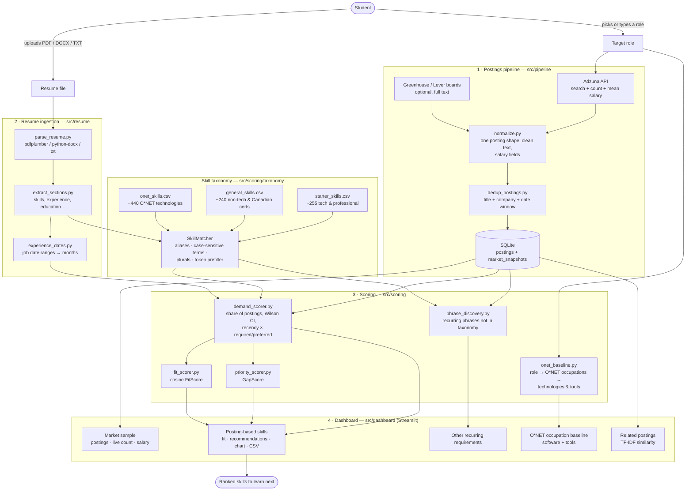
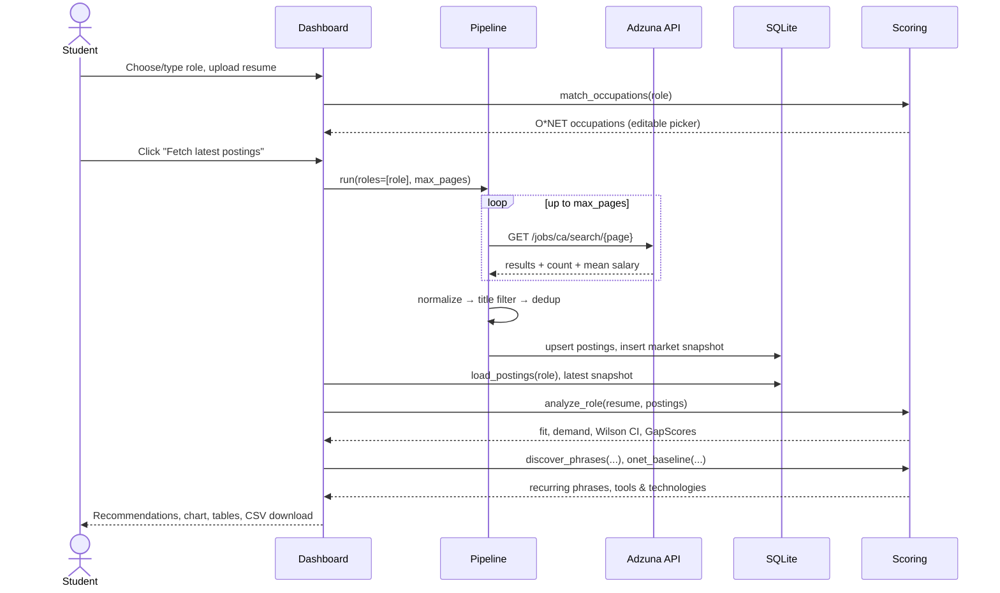
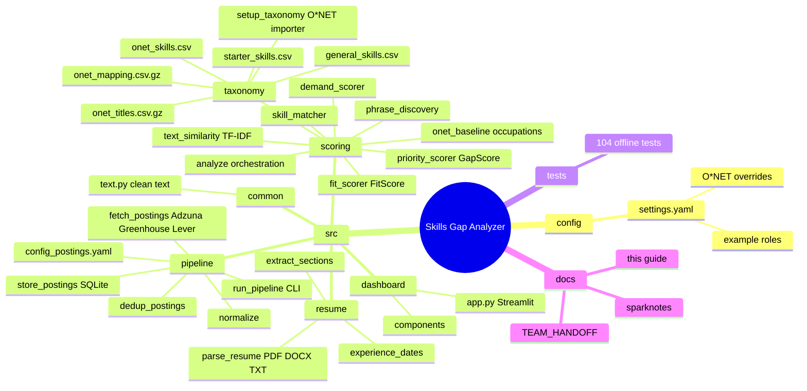
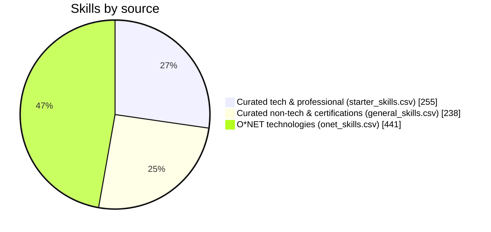
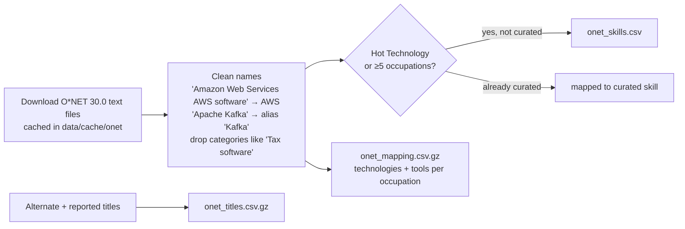
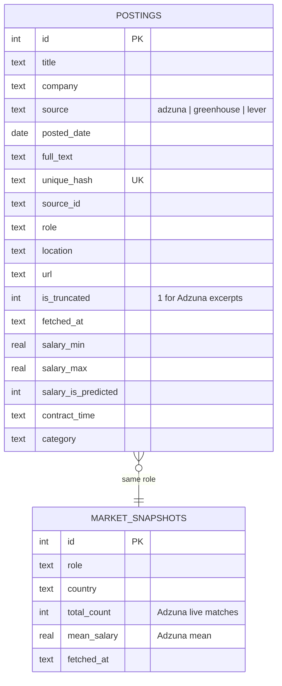
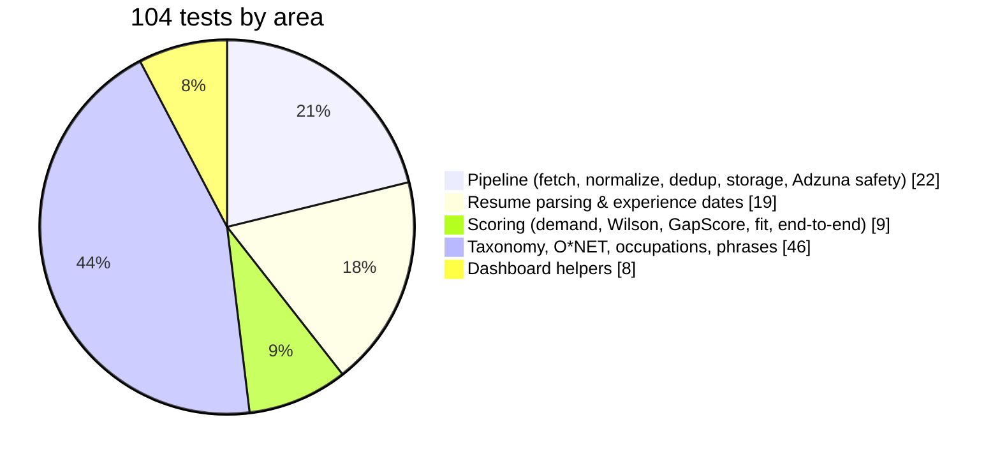

# Job Posting Skills Gap Analyzer — Complete Guide

> [!summary] TL;DR
> Upload a resume, pick or type **any** job title, and the app tells you which skills employers are asking for that your resume doesn't show.
> - **Postings:** live from the **Adzuna API** (optional Greenhouse/Lever company boards).
> - **Skills:** ~**934** skills from two hand-curated lists + **O\*NET 30.0** (free, CC BY 4.0). **Lightcast is no longer needed.**
> - **Any job:** roles are matched to O\*NET occupations through ~**61,000** job titles (tech, healthcare, trades, retail, logistics, office…).
> - **Output:** role fit %, ranked skill gaps with confidence intervals, salary context, recurring requirements the taxonomy misses, and an occupation baseline of tools & technologies.
> - **Quality:** 104 automated tests, no API keys or network needed to run them.

Related notes: [[TEAM_HANDOFF]] · [[sparknotes_main]] · [[sparknotes_priority_method]] · [[Job Posting Skills Gap Analyzer - SparkNotes]]

---

## 1. Process overview

### 1.1 End-to-end flow



### 1.2 What happens in one dashboard session



### 1.3 Project tree map



> [!tip]- Diagram image files (for slides or viewing outside Obsidian)
> The diagrams above are live Mermaid. The same diagrams are exported as SVG in `docs/diagrams/`:
> - [process-flow.svg](diagrams/process-flow.svg)
> - [session-sequence.svg](diagrams/session-sequence.svg)
> - [project-tree-map.svg](diagrams/project-tree-map.svg)
> - [onet-import.svg](diagrams/onet-import.svg)
>
> ![[process-flow.svg]]

### 1.4 Folder tree

```text
skills_gap_analyzer/
├── .env.example                 # ADZUNA_APP_ID / ADZUNA_APP_KEY template (real keys go in .env)
├── README.md
├── requirements.txt
├── pytest.ini
├── config/
│   └── settings.yaml            # example roles, DB path, optional O*NET occupation overrides
├── data/                        # gitignored: skills_gap.db, raw API pulls, O*NET download cache
├── docs/
│   ├── Skills Gap Analyzer - Complete Guide.md   # ← this note
│   ├── TEAM_HANDOFF.md
│   ├── sparknotes_main.md
│   └── sparknotes_priority_method.md
├── src/
│   ├── common/text.py           # clean_text / html_to_text (shared by postings + resumes)
│   ├── pipeline/
│   │   ├── config_postings.yaml # Adzuna country, pages, max_days_old, where, boards, title filter
│   │   ├── fetch_postings.py    # Adzuna (keys redacted in errors), Greenhouse, Lever
│   │   ├── normalize.py         # one posting dict shape incl. salary fields
│   │   ├── dedup_postings.py    # cross-source duplicate removal
│   │   ├── store_postings.py    # SQLite: postings + market_snapshots
│   │   └── run_pipeline.py      # CLI + function used by the dashboard
│   ├── resume/
│   │   ├── parse_resume.py      # PDF / DOCX / TXT → clean text
│   │   ├── parse_pdf.py, parse_docx.py
│   │   ├── extract_sections.py  # skills / experience / education …
│   │   └── experience_dates.py  # date ranges → months, overlap merge
│   ├── scoring/
│   │   ├── skill_matcher.py     # taxonomy loading + fast matching + mask()
│   │   ├── demand_scorer.py     # demand, Wilson CI, weighted demand
│   │   ├── priority_scorer.py   # GapScore
│   │   ├── fit_scorer.py        # cosine FitScore
│   │   ├── analyze.py           # analyze_role() orchestration
│   │   ├── onet_baseline.py     # role → occupations; tools & technologies
│   │   ├── phrase_discovery.py  # recurring phrases not in taxonomy
│   │   ├── text_similarity.py   # TF-IDF related postings
│   │   ├── utils.py             # recency + requirement weights
│   │   └── taxonomy/
│   │       ├── starter_skills.csv     # curated tech/professional (hand-edited)
│   │       ├── general_skills.csv     # curated non-tech + Canadian certs (hand-edited)
│   │       ├── onet_skills.csv        # generated
│   │       ├── onet_mapping.csv.gz    # generated
│   │       ├── onet_titles.csv.gz     # generated
│   │       └── setup_taxonomy.py      # O*NET importer
│   └── dashboard/
│       ├── app.py               # Streamlit entry point
│       ├── utils.py             # settings, salary summary, CSV export
│       └── components/          # role selector, upload, gaps, chart, phrases, baseline
└── tests/                       # test_pipeline / resume / scoring / taxonomy / dashboard
```

---

## 2. Setup and running

> [!tip] Requirements
> Python 3.10+ (tested on **3.12**), an Adzuna developer account (free) — https://developer.adzuna.com/

1. Unzip / clone the project and open a terminal in `skills_gap_analyzer/`.
2. Create the environment:
   ```bash
   python -m venv venv
   venv\Scripts\activate            # macOS/Linux: source venv/bin/activate
   pip install -r requirements.txt
   ```
3. Copy `.env.example` → `.env` and fill in:
   ```ini
   ADZUNA_APP_ID=your_id
   ADZUNA_APP_KEY=your_key
   ```
4. Start the dashboard:
   ```bash
   streamlit run src/dashboard/app.py
   ```
5. In the sidebar: pick a role (or **Other** → type any title), upload a resume, click **Fetch latest postings for this role**.

Command-line alternatives:

```bash
python -m src.pipeline.run_pipeline --roles "Registered Nurse" "Electrician" --max-pages 2
python -m src.scoring.taxonomy.setup_taxonomy      # rebuild O*NET files (optional)
python -m pytest                                    # run all 104 tests
```

> [!warning] API keys
> `.env` is gitignored — **never commit it**. Adzuna error messages are redacted so keys never appear in the dashboard or logs.

> [!note] Git
> All work is on branch `feature/onet-taxonomy-adzuna-complete`, staged but not committed (this machine had no git identity). Run `git config user.name "…"`, `git config user.email "…"`, then `git commit`.

---

## 3. Configuration reference

### `src/pipeline/config_postings.yaml`

| Key | Default | Meaning |
|---|---|---|
| `adzuna.country` | `ca` | Adzuna country code (`ca`, `us`, `gb`, …) |
| `adzuna.results_per_page` | `50` | Postings per API call |
| `adzuna.max_pages_per_role` | `5` | Pages per fetch (dashboard slider overrides). 1 page = 1 API call; free tier ≈ 1,000 calls/month |
| `adzuna.request_delay_seconds` | `1` | Pause between pages |
| `adzuna.max_days_old` | `90` | Only postings newer than N days (0 = no limit) |
| `adzuna.where` | `""` | Optional location, e.g. `"Toronto"` |
| `adzuna.title_filter` | `true` | Keep only titles containing every word of the role |
| `greenhouse_boards` / `lever_boards` | `[]` | Company boards for full-text postings |
| `target_roles` | 12 examples | Roles for the CLI pipeline |

### `config/settings.yaml`

| Key | Meaning |
|---|---|
| `database_path` | SQLite file (default `data/skills_gap.db`) |
| `target_roles` | Roles in the dashboard dropdown (any other can be typed) |
| `onet_occupations` | **Optional** role → O\*NET-SOC code overrides; other roles are matched automatically |

---

## 4. Data sources

| Source | Used for | Access | License / terms |
|---|---|---|---|
| **Adzuna API** | Live postings, total live count, mean salary, salary ranges | Free key | Show "Jobs by Adzuna" attribution (done in footer) |
| Greenhouse / Lever | Optional full-text postings for chosen companies | No key | Public job board APIs |
| **O\*NET 30.0** — Technology Skills, Tools Used, Occupation Data, Alternate Titles, Reported Titles | Technologies, tools, ~61k job titles for all 1,016 occupations | Free download | **CC BY 4.0** — attribution in README + dashboard footer |
| Curated CSVs | Authoritative skills, aliases, Canadian licences/certs | In repo | Project-owned |
| ~~Lightcast Open Skills~~ | *Replaced* | Needed an approved account | — |

> [!quote] Required O\*NET attribution
> This project includes information from the O\*NET 30.0 Database by the U.S. Department of Labor, Employment and Training Administration (USDOL/ETA). Used under the CC BY 4.0 license. O\*NET® is a trademark of USDOL/ETA. Modifications (curated taxonomy, name cleaning) are by this project and not endorsed by USDOL/ETA.

---

## 5. Skill taxonomy

### 5.1 Composition (934 skills, 124 categories)



| File | Edited | Contents |
|---|---|---|
| `starter_skills.csv` | by hand | Programming, data, cloud, BI, ML, DevOps, web, business systems, professional skills |
| `general_skills.csv` | by hand | Customer service & retail · food & hospitality · healthcare · skilled trades · health & safety · transportation & logistics · administrative · accounting & finance · sales & marketing · HR · education & childcare · legal · community & social services · security · cleaning & facilities · manufacturing & engineering · science & lab · personal services · agriculture · languages · background checks |
| `onet_skills.csv` | generated | O\*NET technologies that are "Hot Technology" or used by 5+ occupations, not already curated |
| `onet_mapping.csv.gz` | generated | Every occupation → its technologies (`kind=technology`) and tools (`kind=tool`) |
| `onet_titles.csv.gz` | generated | ~61k titles → occupation (occupation / alternate / reported) |

### 5.2 CSV format

```csv
skill_name,category,aliases,case_sensitive_terms
Microsoft Excel,Data Analysis,MS Excel|advanced Excel,Excel
Forklift Operation,Transportation & Logistics,forklift|reach truck|lift truck,
R,Programming Languages,R programming|RStudio,R
```

### 5.3 Matching rules

- **Case-insensitive, word-boundary** matching on name + aliases (`Java` ≠ `JavaScript`).
- **Plural-tolerant**: `reach trucks` matches `reach truck`.
- **`case_sensitive_terms`** for short/ambiguous words, with strict edges:
  - `R` doesn't match "R&D"; `C` doesn't match "C-suite", "C++" or "C#"
  - `Excel` doesn't match "you will excel"; `Spark`, `Swift`, `Workday`, `Bootstrap` likewise
  - short O\*NET acronyms (`MRP`, `SSO`, `FEA`) only in capitals
- **Curated wins**: an O\*NET term already used by a curated skill is merged into it, never duplicated.
- **Boilerplate-safe**: "competitive compensation", "health insurance", "flexible scheduling", "mental health days" are not skills (regression-tested).
- Curly quotes are normalized (`driver’s licence` = `driver's licence`).
- **Speed**: compiled once per process, patterns prefiltered by first token → ~0.15 s for 250 postings.

### 5.4 How O\*NET is imported



---

## 6. Scoring

For each skill $s$ found in a sample of $N$ postings:

**Demand** — share of postings mentioning the skill, with a 95% **Wilson** interval:

$$\text{demand}(s) = \frac{x_s}{N}, \qquad
\text{CI} = \frac{\hat p + \frac{z^2}{2N} \pm z\sqrt{\frac{\hat p(1-\hat p)}{N} + \frac{z^2}{4N^2}}}{1 + \frac{z^2}{N}},\; z = 1.96$$

**Weighted demand** — recent and required mentions count more:

$$\text{wd}(s) = \frac{\sum_{p \ni s} r_p \cdot q_{p,s}}{\sum_{p} r_p}$$

| Weight | Value |
|---|---|
| Recency $r_p$: < 30 days / 30–90 days / > 90 days / unknown | 1.0 / 0.7 / 0.4 / 0.7 |
| Requirement $q_{p,s}$: required / preferred ("nice to have", "asset", "bonus") | 1.0 / 0.5 |

**GapScore** — what to learn next:

$$\text{GapScore}(s) = \text{wd}(s) \times \big(1 - \text{has}(s)\big)$$

**FitScore** — cosine similarity between the resume vector (0/1 per skill) and the weighted-demand vector, × 100.

> [!info] Evidence, not score
> Months of dated experience per skill are shown in the table but don't change GapScore. The O\*NET baseline, recurring phrases and TF-IDF similarity are also shown separately and **never** change GapScore or FitScore.

---

## 7. Dashboard tour

| Section | What it shows |
|---|---|
| **Sidebar** | Role (dropdown or typed), resume upload, Adzuna key status, pages slider, fetch button |
| **Job market sample** | Postings in sample · Adzuna live listings · median advertised salary (sample) · Adzuna mean salary; postings browser with links; warnings for < 20 postings and Adzuna excerpts |
| **Matching occupation** | Auto-picked O\*NET occupations (editable, searchable across all 1,016) |
| **Posting-based skills** | Role fit · in-demand skills you have · gaps · top-5 recommendations · demand chart with Wilson intervals · full table · CSV download |
| **Other recurring requirements** | Frequent phrases not in the taxonomy (e.g. "steel-toe boots", "cross-border routes") and which your resume lacks |
| **O\*NET occupation baseline** | Software & technology (Hot/In-Demand flags) and Tools & equipment, with resume coverage |
| **Related postings** | Postings most similar to your resume (TF-IDF) + keyword hits |

Works **without a resume** too: shows what the role asks for.

---

## 8. Database schema



Re-running the pipeline never duplicates rows (`unique_hash`); an Adzuna excerpt is upgraded in place when a full-text copy arrives. Older databases are migrated automatically by `init_db()`.

---

## 9. Module contracts (for developers)

| Function | Returns |
|---|---|
| `src.pipeline.run_pipeline.run(roles, max_pages, db_path)` | `{"fetched", "unique", "written", "errors", "market"}` |
| `src.pipeline.store_postings.load_postings(role, db_path)` | posting dicts (shape documented in `normalize.py`) |
| `src.pipeline.store_postings.load_latest_market_snapshot(role, db_path)` | `{role, country, total_count, mean_salary, fetched_at}` or `None` |
| `src.resume.parse_resume.parse_resume(file, filename=None)` | clean text, or `ResumeParseError` (safe to show) |
| `src.scoring.skill_matcher.SkillMatcher().match(text)` / `.mask(text)` | matched `Skill`s / text with known terms removed |
| `src.scoring.analyze.analyze_role(resume_text, postings)` | `{postings_count, resume_skills, fit_score, skills, gaps, …}` |
| `src.scoring.onet_baseline.match_occupations(role)` | `[{soc, occupation, matched_title, score}]` |
| `src.scoring.onet_baseline.onet_baseline(codes, resume_skills, resume_text=, kind=)` | technologies or tools with `has_skill`, `in_demand`, `occupations` |
| `src.scoring.phrase_discovery.discover_phrases(postings, matcher, resume_text, role)` | `[{phrase, count, share, in_resume}]` |

---

## 10. Tests



All tests run offline on synthetic Adzuna/Greenhouse/Lever-shaped data:

```bash
python -m pytest
```

Notable regression checks: ambiguous terms (R&D, C-suite, "excel"), benefits boilerplate, API keys never leak in errors, occupation matching for 10 job types (nurse, PSW, electrician, forklift, AZ driver, accountant, CSR, ECE, software developer), and every configured role resolving to an O\*NET baseline.

---

## 11. Maintenance how-tos

> [!example]- Add or fix a skill
> 1. Edit `src/scoring/taxonomy/starter_skills.csv` (tech) or `general_skills.csv` (everything else).
> 2. Add aliases with `|`. Put short/ambiguous terms in `case_sensitive_terms`.
> 3. Avoid aliases that appear in benefits text ("compensation", "insurance", "scheduling").
> 4. Run `python -m pytest` — a duplicate term across two skills fails loudly.

> [!example]- Pin occupations for a role
> Add under `onet_occupations` in `config/settings.yaml`:
> ```yaml
> "Medical Office Assistant": ["43-6013.00"]
> ```
> Codes: https://www.onetonline.org/

> [!example]- Refresh O\*NET data (new release)
> ```bash
> python -m src.scoring.taxonomy.setup_taxonomy --version 30.1
> ```
> Then update the version in the attribution text (README + dashboard footer).

> [!example]- Add full-text company postings
> Add board tokens to `greenhouse_boards` / company names to `lever_boards` in `config_postings.yaml`.

---

## 12. Known limits

> [!warning] Interpret results as estimates
> - **Adzuna excerpts**: descriptions are ~500 characters, so demand from Adzuna-only samples is a **lower bound**.
> - **Small samples**: fewer than ~20 postings → wide intervals (the dashboard warns).
> - **Title filter**: use employer wording ("AZ Driver", not "AZ Truck Driver"), or disable it for broad roles.
> - **O\*NET is U.S. data**: occupations/tools transfer well; provincial licences come from the curated list.
> - **Broad titles** ("Associate", "Coordinator") can map to several occupations — adjust in the picker.
> - **Required vs preferred** is inferred from headings/cue words.
> - **Two-column PDFs** may parse out of order.
> - Not career advice; no resume data is stored.

---

## 13. Troubleshooting

| Symptom | Fix |
|---|---|
| "Adzuna keys are not set" | Create `.env` from `.env.example` in the project root, restart Streamlit |
| "Adzuna rejected the API keys (HTTP 401)" | Check ID/key at developer.adzuna.com |
| 0 postings after fetch | Role wording too specific for the title filter → try employer wording or `title_filter: false` |
| Resume "No readable text found" | Scanned PDF — export from Word/Google Docs as PDF/DOCX, or upload TXT |
| A skill is missed / wrongly matched | Edit the curated CSV aliases (see §11) |
| Wrong occupation in baseline | Change it in the **Matching occupation** picker, or pin it in `settings.yaml` |

---

## 14. Change log

| Phase | Changes |
|---|---|
| **Original prototype** | Adzuna/Greenhouse/Lever pipeline, PDF/DOCX parsing, 43-skill starter taxonomy, demand/GapScore/FitScore, Streamlit dashboard, 50 tests; blocked on Lightcast |
| **Completion** | Lightcast replaced by curated (~255) + O\*NET taxonomy · case-sensitive terms · O\*NET baseline · Adzuna salary/contract/category + market snapshots · `max_days_old`/`where` filters · API-key redaction · TXT resumes · custom roles, page slider, demand chart, CSV export, attribution · 83 tests |
| **All jobs** | `general_skills.csv` (~240 non-tech + Canadian certs) · O\*NET for all 1,016 occupations · tools baseline · automatic role → occupation matching (~61k titles, abbreviations) · recurring-phrase discovery · plural tolerance · fast token-indexed matcher · works without a resume · 104 tests |
